 

## 🧱 What we do

Most small and growing businesses juggle a web agency, a marketing agency, a GST accountant, an app freelancer and someone else for the CRM — and the owner ends up as the glue between them.

> **Ascelstack replaces that patchwork with one team and one connected stack.**
> We build the systems, grow the business on top of them, then automate the day-to-day so it keeps moving on its own.

## 🔷 Three layers, one stack

## 📦 Service catalogue

| Discipline | Layer | Services | Status |
|:--|:--:|--:|:--:|
| 💻 Software & Web | 🏗️ Build | 20 | 🟢 Live |
| 🤖 AI & Automation | 🏗️ Build | 16 | 🟢 Live |
| 📣 Marketing | 📈 Grow | 18 | 🟢 Live |
| 🎨 Brand & Creative | 📈 Grow | 16 | 🟢 Live |
| 🛒 E-commerce | 📈 Grow | 16 | 🟢 Live |
| 🗂️ Operations | ⚙️ Run | 19 | 🟢 Live |
| 🍽️ Restaurants | ⚙️ Run | 20 | 🟢 Live |
| 🧾 Compliance | ⚙️ Run | 75 | 🟢 Live |
| 🖥️ IT Infrastructure | 🏗️ Build | 9 | 🟡 Coming soon |
| 👥 HR & Hiring | ⚙️ Run | 7 | 🟡 Coming soon |
| 🎓 Training | 📈 Grow | 5 | 🟡 Coming soon |
| 🧭 Consulting | 📈 Grow | 7 | 🟡 Coming soon |
| 🏢 Corporate | 🏗️ Build | 4 | 🟡 Coming soon |

## 🎯 Who we serve

<table>
<tr>
<td width="33%" valign="top" align="center">

### 🍽️
**Restaurants & cafés**

Swiggy & Zomato onboarding · direct ordering · POS & KDS · menus · reviews · FSSAI compliance

</td>
<td width="33%" valign="top" align="center">

### 🛒
**E-commerce sellers**

Amazon, Flipkart & Meesho onboarding · Shopify / WooCommerce · catalogue SEO · inventory sync · GST & IEC

</td>
<td width="33%" valign="top" align="center">

### 🚀
**Startups & MSMEs**

Company registration · trademarks · product development · brand launch · lead generation · back-office systems

</td>
</tr>
</table>

## 🔁 How an engagement runs

<b>What happens at each step</b>

 

1. **Discover** — map every hand-off, tool and spreadsheet.
2. **Design** — brand, UI and workflows signed off before any code.
3. **Build** — shipped in short, demoable cycles.
4. **Automate** — agents and workflows switched on with a human checkpoint at each step.
5. **Operate** — monitoring, maintenance and a weekly report.

## 💡 Why one stack

| | |
|:--|:--|
| 🤝 **One team, one point of contact** | instead of five vendors |
| 🔗 **Connected by default** | store, CRM, invoices and reports share the same data |
| ⚡ **Automation built in** | workflows and AI agents handle the repetitive work |
| 🛡️ **Compliance included** | growth never blocked by a missing licence or filing |

## 🛠️ Tech we build with

  

## 🌐 Featured project

<table>
<tr>
<td>

### [Ascelstack website ↗](https://github.com/Sujoymoulick/Ascelstack)

A static Astro site with a real-time **3D "Layered A" hero** (Three.js / WebGL), scroll-driven motion (GSAP + Lenis), a searchable catalogue of **232 services** and animated automation walkthroughs.

`astro` `threejs` `gsap` `lenis` `typescript` `webgl`

</td>
</tr>
</table>

 

© 2026 Ascelstack · Build · Grow · Run

